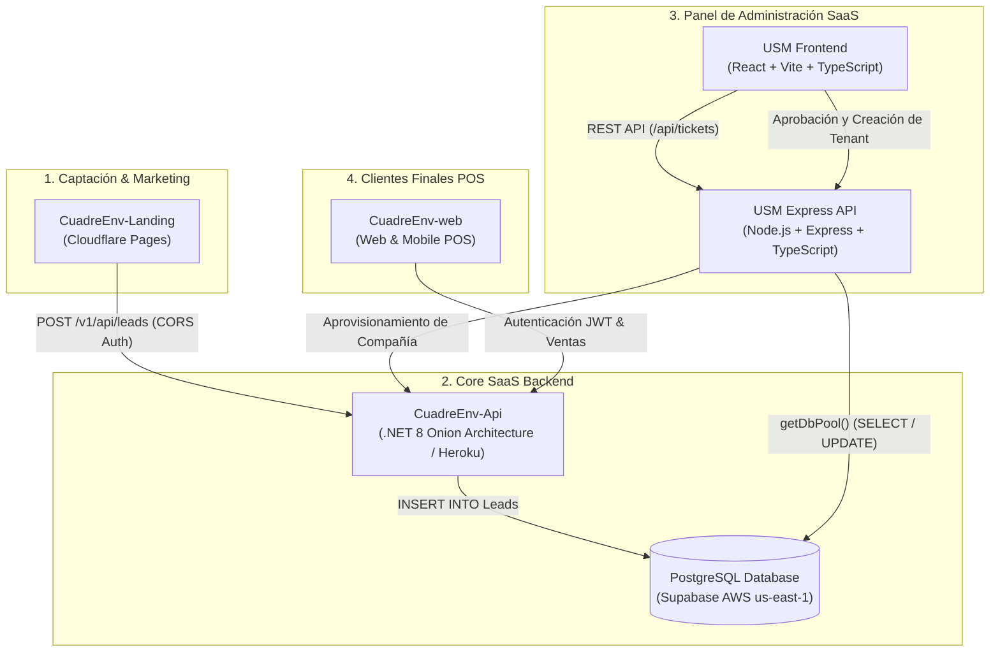
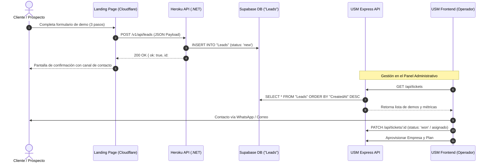

# Ecosistema CuadreEnv — Arquitectura y Documentación del Sistema

CuadreEnv es una plataforma SaaS integral de Punto de Venta (POS), Facturación Fiscal (NCF/DGII), Control de Inventario y Cuadre de Caja diseñada para comercios y empresas en la República Dominicana y Latinoamérica.

Este documento describe la arquitectura global, los subsistemas que componen la plataforma, sus flujos de datos y la integración entre la captación de prospectos y la administración central.

---

## 1. Visión General y Propósito

El propósito de CuadreEnv es erradicar el estrés del cuadre de caja diario y la gestión informal en comercios físicos y de servicios mediante:
- **Punto de Venta Ágil (POS):** Venta rápida mediante teclado, escaneo por código de barras o POS móvil desde el teléfono celular.
- **Cuadre Ciego de Caja:** Evita el cuadre manipulado forzando al cajero a declarar lo recaudado antes de ver la diferencia (`RD$ 0.00`).
- **Cumplimiento Fiscal DGII:** Emisión automatizada de comprobantes fiscales electrónicos y tradicionales (B01, B02, B14, B15, etc.).
- **Multi-sucursal y Multi-almacén:** Administración centralizada de existencias, transferencias de mercancía y precios por sucursal.
- **Cuentas por Cobrar (CxC):** Registro de clientes a crédito, límites de endeudamiento y liquidación de deudas ("control de fiao").
- **Operación Offline:** Capacidad de seguir facturando en el punto de venta ante cortes de energía o internet.

---

## 2. Mapa de Arquitectura del Ecosistema

El ecosistema CuadreEnv opera mediante una arquitectura desacoplada y orientada a servicios:

---

## 3. Componentes del Ecosistema

### A. CuadreEnv-Landing (Landing Page & Captación)
* **Repositorio:** `CuadreEnv-Landing`
* **Hosting:** Cloudflare Pages (`https://cuadreenv-landing.pages.dev`)
* **Tecnología:** Vite + Vanilla JavaScript moderno (ES Modules) + CSS3 nativo sin frameworks pesados.
* **Rol:**
  - Presentación comercial interactiva de funciones, módulos, beneficios y casos de uso.
  - Simulador visual de POS y escáner de códigos de barras móvil.
  - Formulario de solicitud de demostraciones (Lead Stepper en 3 fases) con protección anti-spam (*honeypot*).
  - Envía la solicitud de demo al endpoint público `POST /v1/api/leads`.

### B. CuadreEnv-Api (API Core de Negocio SaaS)
* **Repositorio:** `CuadreEnv-Api`
* **Hosting:** Heroku (`https://cuadreenv-api-86ef5ddf9650.herokuapp.com`)
* **Tecnología:** .NET 8 (Arquitectura Onion: Domain, DataAccess, BusinessLogic, Controllers).
* **Rol:**
  - Núcleo transaccional de facturación, ventas, secuencias NCF, inventario y usuarios.
  - Exposición de endpoints REST seguros con JWT y control de CORS (`Cors__AllowedOrigins`).
  - Controlador `LeadsController.cs` (`POST /api/leads` y `/v1/api/leads`) para inserción directa en la base de datos PostgreSQL.

### C. Base de Datos Central (Supabase PostgreSQL)
* **Proveedor:** Supabase (AWS us-east-1 Pooler)
* **Tablas Principales:**
  - `"Leads"`: Prospectos comerciales capturados desde la landing (nombre, empresa, tipo de negocio, teléfono, módulos de interés, UTM, etc.).
  - `"Companies"` y `"CompanySettings"`: Configuración multitenant de las empresas registradas.
  - `"Users"` y `"Roles"`: Usuarios cajeros, administradores y permisos granulares.
  - `"Sales"`, `"SaleDetails"`, `"Payments"`: Registro histórico de transacciones comerciales.
  - `"FiscalSequences"`: Control estricto de números de comprobante fiscal (NCF).

### D. USM — User Management System (Panel de Operaciones SaaS)
* **Repositorio:** `USM`
* **Componentes:**
  1. **`express-api` (Backend Adapter):**
     - Desarrollado en Node.js, Express y TypeScript.
     - Conectado directamente a PostgreSQL vía `getDbPool()`.
     - Implementa las rutas `/api/tickets` y `/api/tickets/stats` para consultar, filtrar, clasificar y actualizar el estado de los leads y solicitudes de demos.
     - Servicio de correos para enviar credenciales y cotizaciones comerciales.
  2. **`frontend-react` (Dashboard Administrativo):**
     - Desarrollado en React, TypeScript y Vite.
     - Pantalla de **Tickets / Prospectos Comercial**:
       - Muestra estadísticas en tiempo real (Total, Últimos 7 días, por estado y por tipo de comercio).
       - Drawer lateral de detalle del interesado con enlaces directos para contactar por **WhatsApp** o **Correo electrónico**.
       - Botón **"Crear Usuario desde Lead"**: provisiona automáticamente la empresa y usuario administrador en el sistema con los módulos solicitados.

### E. CuadreEnv-web (Aplicación POS Cliente)
* **Repositorio:** `CuadreEnv-web`
* **Rol:** Sistema que utilizan los cajeros y encargados de negocio en el mostrador o en el teléfono móvil para registrar ventas, abrir turnos de caja, cobrar con múltiples métodos de pago (Efectivo, Tarjeta, Transferencia) y realizar el cuadre final de turno.

---

## 4. Ciclo de Vida de una Solicitud de Demo (Lead Flow)

---

## 5. Módulos Funcionales del Sistema

| Módulo | Identificador | Descripción |
| :--- | :--- | :--- |
| **Punto de Venta (POS)** | `pos` | Facturación ágil, búsqueda rápida, lectura de códigos de barra y tickets térmicos. |
| **Cuadre de Caja** | `caja` | Apertura de turno con monto base, registro de entradas/salidas y cuadre ciego con conteo de billetes. |
| **Control de Inventario** | `inventario` | Kardex de movimientos, existencias en tiempo real, alertas de stock mínimo y multi-almacén. |
| **Facturación Fiscal DGII** | `facturacion` | Emisión automática de NCF (Crédito Fiscal B01, Consumo B02, Regímenes Especiales B14, Gubernamental B15). |
| **Cuentas por Cobrar** | `cxc` | Gestión de créditos ("fiao"), límites por cliente, estados de cuenta y abonos parciales. |
| **Multi-Sucursal** | `multi-sucursal` | Consolidación de información de diferentes puntos de venta en una sola cuenta de empresa. |
| **POS Móvil** | `pos-movil` | Venta y escaneo de códigos de barra utilizando la cámara del teléfono celular. |
| **Reportes y Analíticas** | `reportes` | Reportes 606 y 607 para DGII, margen de ganancia, productos más vendidos y rendimiento por cajero. |

---

## 6. Seguridad y Políticas de Red

1. **Protección CORS:**
   - La API central en Heroku restringe las solicitudes de orígenes cruzados a través de `Cors__AllowedOrigins`, admitiendo de manera explícita los dominios de la Landing (`https://cuadreenv-landing.pages.dev`), del USM y de desarrollo local.
2. **Protección Anti-Bot (Honeypot):**
   - El formulario de la landing incluye el campo oculto `website`. Si es completado por un bot automático, la petición es simulada como exitosa pero descartada en la base de datos.
3. **Autenticación Basada en Roles (RBAC):**
   - Los accesos a las API operativas requieren tokens JWT firmados digitalmente (`Bearer`).
   - Jerarquía de roles: SuperAdmin SaaS -> Administrador de Tenant -> Cajero / Vendedor.

